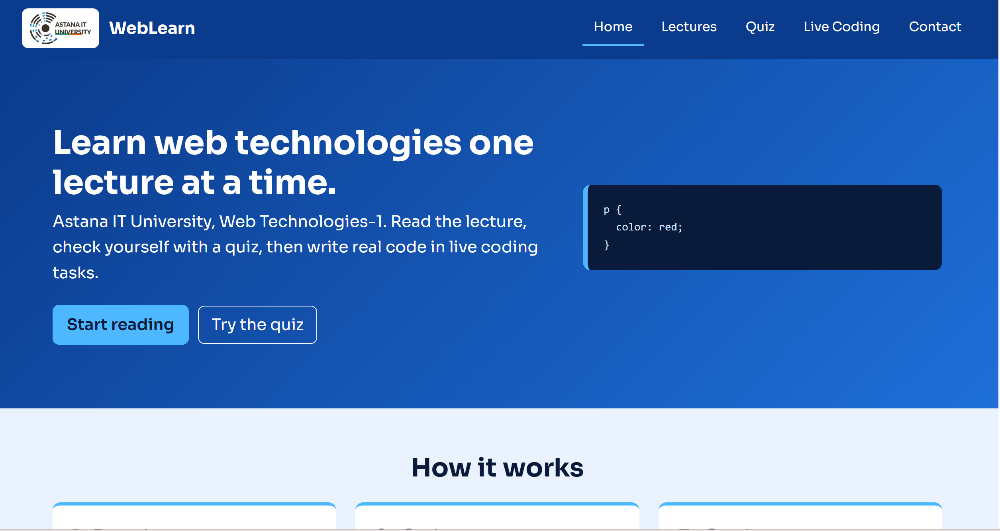
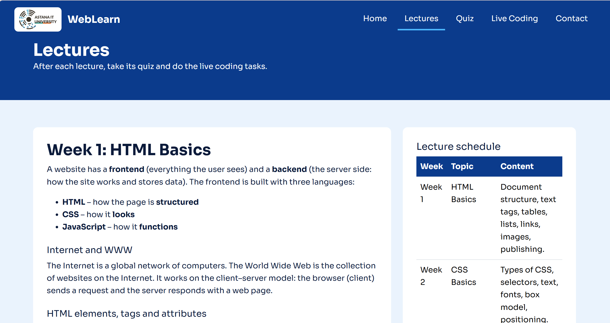
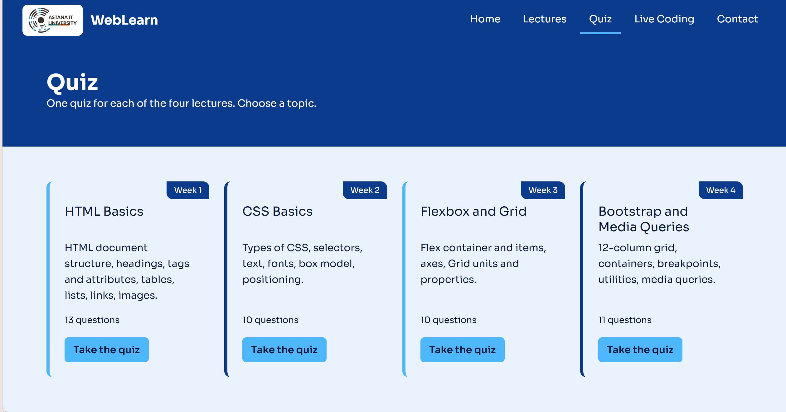
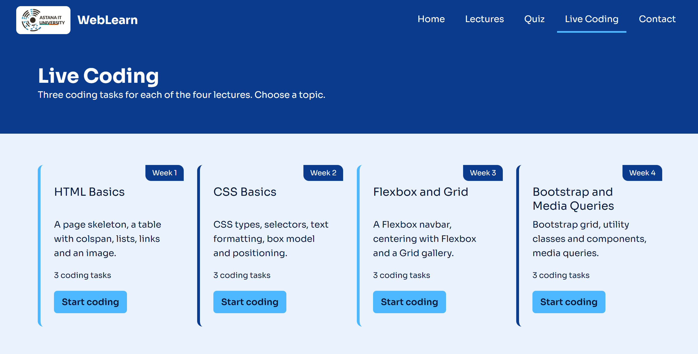
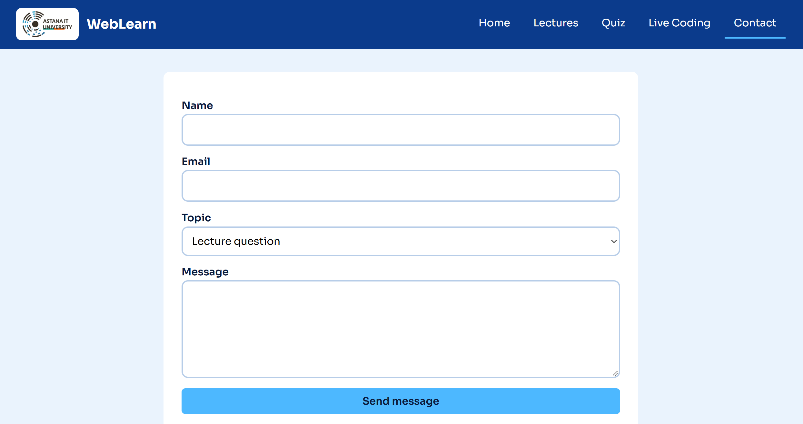
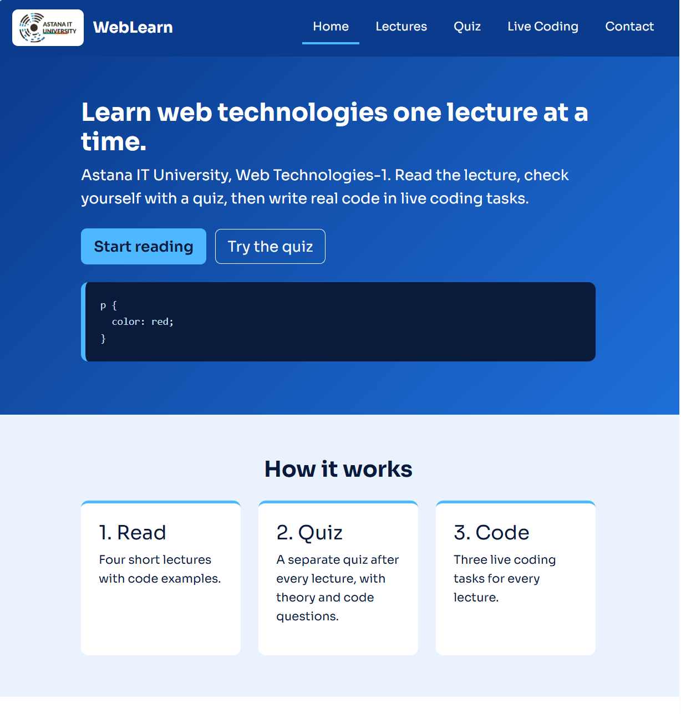

# WebLearn: Online Courses Website

Website: https://muratovaajdana201-ctrl.github.io/weblearn-midterm/

## Project title and topic

WebLearn is a small website for learning web development. Our topic is the Web Technologies-1 course itself: a student reads a lecture, takes a quiz about it, and then tries to write code in three short tasks.

## Group members

-Aidana Muratova
-Zhasmira Mamyrbayeva
-Khanzada Nyshanbek

## Short description

We took the first four weeks of the course and put them on the site:

-Week 1: HTML Basics
-Week 2: CSS Basics
-Week 3: Flexbox and Grid
-Week 4: Bootstrap and Media Queries

Every week goes the same way. You read the lecture, then press "Take the quiz", then "Live coding". These two buttons are at the end of each lecture, so you don't have to look for the right page. The site has 14 pages, 44 quiz questions and 12 coding tasks.

## Screenshots

Home page:

Lectures page with the schedule table:

Quiz page, where you choose a week:

Quiz for week 1:

.png)

Live coding page, where you choose a week:

Contact page:

Home page on a narrower screen:

## Project structure

-index.html: home page
-lectures.html: the four lectures and the schedule table
-quiz.html: page where you choose a quiz
-quiz-week1.html, quiz-week2.html, quiz-week3.html, quiz-week4.html: the quizzes
-live-coding.html: page where you choose coding tasks
-live-coding-week1.html, live-coding-week2.html, live-coding-week3.html, live-coding-week4.html: the coding tasks
-contact.html: contact form
-thank-you.html: page you see after sending the form
-css/style.css: our only CSS file
-img/aitu-logo.png: university logo
-screenshots/: pictures for this README
-README.md: this file

## What we did in this project

-We made 14 pages with HTML5 and CSS3, and all of them have the same header and footer.
-The header has the logo and a menu made with Flexbox. The page you are on is underlined, and the header stays at the top when you scroll (position: sticky).
-On small screens the menu turns into a hamburger button. We did it with a hidden checkbox and CSS, without JavaScript.
-We wrote the text of all four lectures on one page, with code examples, a few tables and a schedule table.
-We made one quiz for each lecture. Some questions are about theory and some are about code. Every question has three answers and a short explanation.
-The "Check Answers" button also works without JavaScript. There is a hidden checkbox at the top of the form. When it is checked, CSS selectors (~ and +) make the right answer green, the wrong one red and show the explanation. "Try again" is a simple reset button.
-We made three coding tasks for each lecture. Each task has requirements, an expected result, a place to write your code and a "Show Solution" button. This button works the same way as the quiz.
-We added the "Take the quiz" and "Live coding" buttons at the end of each lecture.
-We made a contact form with required fields. After sending it you get to thank-you.html .
-We wrote css/style.css ourselves. It has CSS variables, Flexbox, Grid, positioning, :hover, :focus, :focus-visible and :nth-child().
-We added Bootstrap 5.3.3 for the grid, buttons and some utility classes.
-For different screen sizes we used the Bootstrap grid and our own media queries (992px, 768px and 576px).
-We used the Google font Sora, wrote alt text for images and added loading="lazy" to the images below the top of the page.
-At the end we put the project on GitHub Pages.

## Features implemented

-Header and footer on every page
-Hamburger menu on small screens
-Tables, lists, links, images and forms
-External CSS with variables, Flexbox, Grid and positioning
-Responsive design
-Quizzes with answer checking and explanations
-Coding tasks with solutions
-Contact form and confirmation page

## Technologies used

-HTML5
-CSS3
-Bootstrap 5.3.3 (from a CDN)
-Google Fonts (Sora)
-GitHub Pages

## How to run

Download the project and open index.html in a browser. You don't need to install anything. Bootstrap and the font come from the internet, so without a connection the site will look different.

## Limitations

- There is no JavaScript on the site, so the quiz only shows which answers are right. It does not count points or save anything.
- The contact form does not send a real email. The email and social links in the footer are placeholders.

# WebLearn: Online Courses Website(Endterm)

## Short description
A responsive website (midterm) extended with JavaScript and jQuery interactivity (endterm). It has **nine lectures**: Week 1 (HTML Basics), Week 2 (CSS), Week 3 (Flexbox and Grid), Week 4 (Bootstrap and Media Queries), Week 5 (Bootstrap Grid and Components), Week 6 (JavaScript Basics), Week 7 (Arrays, Loops and DOM Manipulation), Week 8 (JS Events and Form Validation) and Week 9 (jQuery). After each lecture the student takes the quiz for that lecture and then does three live coding tasks. At the end there is a Final Test for all nine lectures.

Pages: Home, Lectures, Quiz (hub + one quiz page per lecture), Live Coding (hub + one page per lecture), Final Test, Topics (search and filter), Students (CRUD table), Gallery (lightbox), Register (validated form), Developers, Contact (+ thank-you page).

## Features implemented

## Endterm: what we added

The endterm project extends the midterm website (same topic and structure) with interactivity and dynamic behavior. All JavaScript and jQuery code is in js/script.js; jQuery 3.7.1 is loaded from the CDN and Bootstrap 5.3 JS is used for modals. All midterm pages, the responsive layout and the CSS-only quizzes remain intact.

### 1. Form validation (register.html, contact.html)
Forms use the js-validate class and novalidate, so all checking is done by our own JavaScript before submission.
- **Required fields:** name, email, password, confirm password, message and the "accept terms" checkbox. An empty field shows its own message, for example "Email is required."
- **Name check (RegEx):** letters only (Latin, Cyrillic and Kazakh letters, spaces, hyphen, apostrophe), at least 2 characters.
- **Email check (RegEx):** the address must look like name@mail.com; otherwise a hint with an example is shown.
- **Password rules:** at least 8 characters, and a password that is too weak is rejected with the advice to add digits, capital letters or symbols.
- **Password strength indicator:** a Bootstrap progress bar and a text label show **Weak** (red), **Medium** (yellow) or **Strong** (green). The score depends on length (8+ and 12+), small and capital letters, digits and symbols. It updates on every key press.
- **Password confirmation:** the second field must match the first one. If the user changes the password after filling in the confirmation, the confirmation is checked again automatically.
- **Show / Hide button** for both password fields.
- **Message field** (contact form): required, at least 10 characters.
- **Real-time feedback:** fields are validated on input, blur and change. Each field gets Bootstrap is-valid / is-invalid classes, a green ✓ or red ✗ icon and a text message under the field ("Looks good!" or the error).
- **Blocking submission:** if any field is invalid, preventDefault() stops the form, a Bootstrap alert fades in with the list of fields to fix, and the focus moves to the first wrong field.
- **After success:** the register form shows a success alert with the user's name (inserted safely as text) and resets itself; the contact form is sent to thank-you.html.

### 2. Dynamic search and filter (`topics.html`)
- The page has **33 topic cards** about HTML, CSS, Flexbox & Grid, Bootstrap, JavaScript and jQuery (lectures 1-9).
- **Real-time search:** results change while the user types (.on(input keyup)) without reloading the page. The search is **case-insensitive** and looks in the card title, the description and hidden tags.
- **Category buttons:** All, HTML, CSS, Flexbox & Grid, Bootstrap, JavaScript, jQuery. They work **together with the search bar** (a card is shown only if it matches both the text and the category).
- Cards appear and disappear with jQuery .fadeIn() / .fadeOut().
- A **result counter** ("5 topics found") and a "Nothing found" message when there are no matches.
- A **Clear** button resets the search and returns the focus to the input.

### 3. Dynamic table with CRUD (students.html)
A student list (name, email, current lecture, quiz score) built with jQuery.
- **Read:** the table is drawn dynamically from a JavaScript array; 5 demo students are loaded at the start. The score is shown in a colored badge (90+ high, 70-89 medium, below 70 low). The page also shows the **total number of students** and the **average score**.
- **Create:** the "+ Add student" button opens a Bootstrap modal with a form (name, email, lecture, score 0-100).
- **Update:** the "Edit" button opens the same modal filled with the data of the chosen row.
- **Delete:** the "Delete" button opens a **confirmation modal** with the student's name; after confirmation the row fades out and is removed.
- **Validation inside the modal:** name and email use RegEx, the score must be a number from 0 to 100; errors are shown live under the fields.
- **Feedback:** a Bootstrap alert appears after each action ("Student added", "Student updated", "Student deleted").
- **localStorage:** the data stays after the page is reloaded. The "Reset demo data" button restores the original list. If the list is empty, a message is shown.

### 4. Image gallery with lightbox (gallery.html)
- A grid of images (HTML, CSS, JavaScript, Bootstrap, jQuery) with captions and a hover zoom effect.
- **Category filter buttons** (All, HTML, CSS, JavaScript, Bootstrap, jQuery) with fade transitions.
- **Lightbox:** a click on an image opens it in large size with a caption and a counter ("2 / 5").
- **Navigation arrows** (previous / next) that go around in a circle; keyboard arrows ← → and **Esc** also work, and clicking outside the image closes the lightbox. When a filter is active, the arrows move only through the visible images.
- **jQuery effects:** the lightbox opens with .fadeIn(), and the image changes with .fadeOut() and .fadeIn(). The page scroll is locked while the lightbox is open.
- **Developers page** (developers.html): a similar lightbox for the team photos, with filtering by developer and an .animate() effect (the photo fades in and slides up).

### 5. Final Test (final-test.html)
- 27 questions (3 per lecture, theory and code).
- **Check Answers** shows correct answers, wrong choices and explanations; jQuery counts the score and shows it in percent with the message "Well done, you passed!" (pass mark 70%) or "Review the lectures and try again." The page scrolls smoothly to the result with .animate().
- **Try again** resets the test and hides the score.

### 6. New content
- **Lectures 5-9** (Bootstrap Grid and Components, JavaScript Basics, Arrays / Loops / DOM, JS Events and Form Validation, jQuery) with their own quizzes (quiz-week5.html - quiz-week9.html) and live coding tasks (live-coding-week5.html - live-coding-week9.html).
- The navigation on every page has new links: Final Test, Topics, Students, Gallery, Register, Developers.
- The Topics page has new JavaScript and jQuery categories.

## Technologies used
HTML5, CSS3, Bootstrap 5.3, JavaScript (ES6), jQuery 3.7.1, Regular Expressions, localStorage, Google Fonts, Git and GitHub, GitHub Pages

## Individual contributions

### Khanzada Nyshanbek
- Quizzes for all nine lectures: quiz.html (hub), quiz-week1.html - quiz-week9.html
- index.html 
- css/style.css 
- final-test.html with the jQuery score counter
- students.html: dynamic table with CRUD operations and modals

### Aidana Muratova
- Lectures 1-9: lectures.html (lecture text and the lecture schedule table)
- register.html: registration form
- contact.html and thank-you.html: contact form and confirmation page

### Zhasmira Mamyrbayeva
- Live Coding tasks: live-coding.html (hub) and live-coding-week1.html - live-coding-week9.html
- topics.html: real-time search and category filter
- gallery.html and img/gallery/: image gallery with lightbox
- developers.html and img/developers/

### Shared work
- js/script.js was written by all group members together: form validation, search and filter, CRUD table, gallery and lightbox, final test score.

